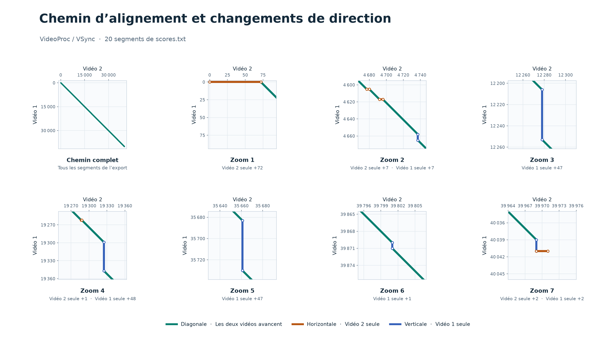
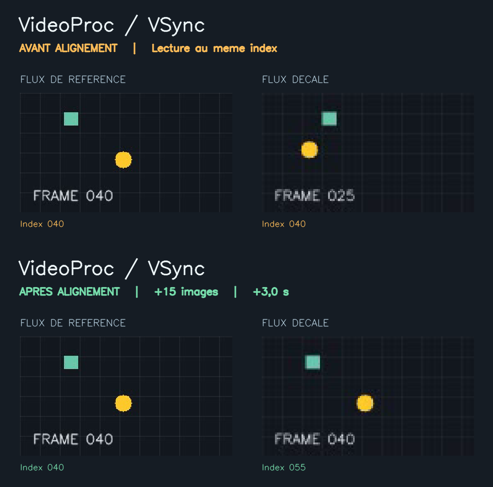

# VideoProc / VSync

Synchroniser deux vidéos d’un même contenu quand elles ont des résolutions ou des points de départ différents.

## Mon travail

Projet individuel en C++ avec OpenCV. Le programme recale spatialement les images, conserve les images utiles dans un tampon circulaire et recherche les correspondances temporelles par programmation dynamique. OpenMP répartit le calcul des scores entre les images.

## Résultat sur les 20 segments exportés

[Ouvrir le graphique interactif](https://ramosmathias.github.io/videoproc-vsync/) ou ouvrir [le fichier HTML](docs/index.html) dans un navigateur depuis une copie locale. Choisir un des sept zooms, utiliser la molette pour agrandir et faire glisser le tracé pour déplacer la vue.



Les sept zooms couvrent tous les passages horizontaux et verticaux de l’[export texte](reproduction/scores-alignement-historique.txt). Les axes gardent les indices d’image de chaque vidéo et les deux axes ont la même échelle dans chaque vue. La diagonale indique que les deux vidéos avancent ensemble. À droite, seule la vidéo 2 avance. Vers le bas, seule la vidéo 1 avance.

[Voir le tracé complet seul](assets/trace-complet.png) · [Voir les segments 3 à 7 image par image](assets/trace-segments.png)

Pour reproduire le graphique avec Python et Matplotlib, lancer `python reproduction/trace-alignement.py reproduction/scores-alignement-historique.txt assets/chemin-et-zooms.png --zooms`.

## Démonstration



[Voir la vidéo comparative de 14 secondes](assets/demonstration-vsync.webm)

Le test utilise un flux de référence à 256 × 144 et un second à 128 × 72, tous deux à 5 images/s. Le flux de basse résolution a été décalé de **15 images**, soit **3 secondes**.

Le test de cette version vérifie le segment **vidéo 1, indices 0 à 115 → vidéo 2, indices 15 à 130**. L’export reproduit le décalage constant de 3 secondes. [Voir la sortie du test](reproduction/scores-ajustement.txt)

Le calcul peut démarrer au premier indice de la vidéo 1 ou plus loin dans la vidéo 2. Cette variante évite de redémarrer le coût à zéro au bord gauche à chaque nouvelle ligne. L’essai automatisé couvre le décalage initial positif à fréquence d’image identique. Les coupures et le décalage dans l’autre sens restent à vérifier.

## Reproduire l’essai sous Windows

La compilation a été vérifiée avec Visual Studio 2022, CMake, OpenMP et OpenCV 4.5.1 x64 avec le module vidéo FFmpeg. Depuis la racine du dépôt, adapter le chemin d’OpenCV à l’installation locale.

```powershell
$opencv = 'C:/chemin/vers/OpenCV_4.5.1/build/x64/vc15'
cmake -S . -B build -G "Visual Studio 17 2022" -A x64 "-DOpenCV_DIR=$opencv/lib"
cmake --build build --config Release
$env:PATH = "$opencv/bin;$env:PATH"
ctest --test-dir build -C Release --output-on-failure
```

Pour exécuter directement la démonstration avec les deux vidéos synthétiques incluses et produire `scores.txt` dans le dossier courant, lancer cette commande.

```powershell
.\build\Release\videoproc.exe reproduction/signal-reference.avi reproduction/signal-decale.avi 17100 20103
```

Les deux derniers arguments sont les temps, en millisecondes, d’une paire d’images servant de repère pour le recalage spatial. Pour garder l’ordre vidéo 1 puis vidéo 2 dans l’export, fournir le flux le plus large en premier.

## Provenance

Projet individuel réalisé à Polytech Paris-Saclay à partir d’un squelette pédagogique. Les vidéos de démonstration ont été générées pour ce dépôt. [Détail des sources et des dépendances](NOTICE.md)
